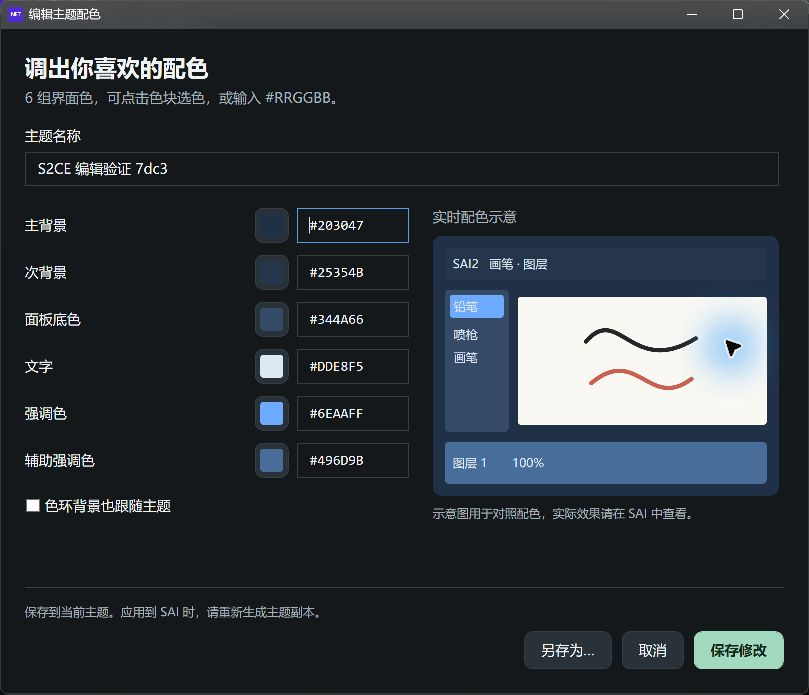
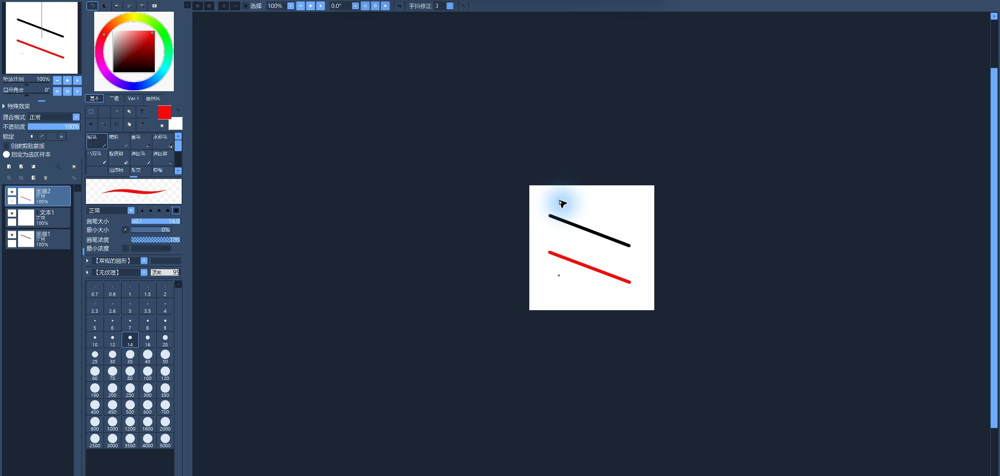

[简体中文](README.md) | **English** | [Русский](README.ru.md)

# SAI 2 - Colored Edition

Change SAI2's interface colors, create custom themes and keep your original program.

[Download](https://github.com/yaya-ccc/sai2-colored-edition/releases) · [Report an issue](https://github.com/yaya-ccc/sai2-colored-edition/issues)

## Use

1. Extract the package, keep all accompanying files and run `S2CE.exe`. Standard packages require .NET 8 Desktop Runtime; self-contained packages do not.
2. Close SAI, click **选择程序…** (Select program) and choose the original `sai2.exe`, with its INI file beside it.
3. Wait for **可换肤** (Supported), then select a theme card.
4. Click **生成主题并启动 SAI** (Generate theme and launch SAI). The tool creates a separate copy and keeps your original EXE and INI unchanged.

The launcher remembers your selection. You can also run `sai2-colored.exe` directly from the SAI installation directory.

Verified **2024.02.22 x64** and **2024.08.14 x64 localized builds** are supported. Use the launcher's detection result to check your executable.

## Customize colors

- Select a preset and click **自定义配色…** (Customize colors). Adjust the six colors using the swatches or `#RRGGBB` values.
- Name your theme and click **保存主题** (Save theme).
- To edit a user theme, click **编辑配色…** (Edit colors) or double-click its card. **保存修改** (Save changes) updates it; **另存为…** (Save as) keeps the original and creates a copy.
- Return to the main window and click **生成主题并启动 SAI** to apply the saved palette.

User themes are stored in `%LOCALAPPDATA%\S2CE\themes`. Share a JSON file from this folder; the recipient places it in their own user theme folder and reopens the launcher.

## Restore the original

Close SAI and click **恢复原版并启动** (Restore and launch original). The tool removes the verified themed copy and starts the original.

## SAI2 preview

---

Maintained by [yaya-ccc](https://github.com/yaya-ccc), based on [supchyan's original project](https://github.com/supchyan/sai2-colored-edition).
